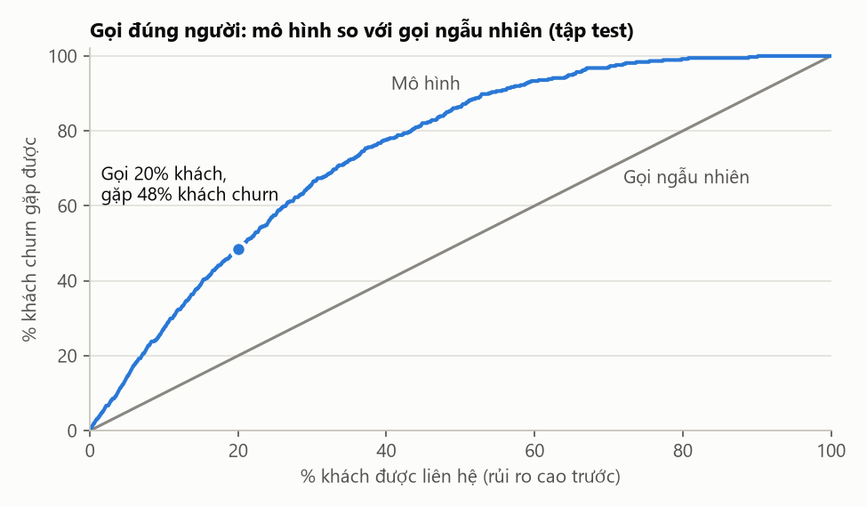
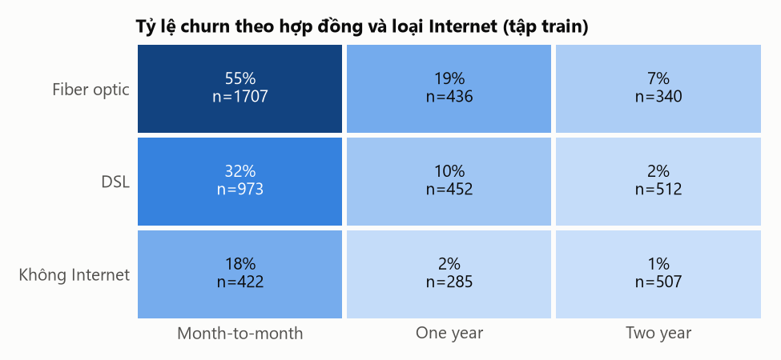

# Dự đoán khách hàng rời mạng (Telco Customer Churn)

Từ dữ liệu thô đến REST API chạy trong Docker, với trọng tâm là **đánh giá trung thực**: tập test chỉ dùng để đo, mọi lựa chọn về mô hình đều làm trên tập train.

**Kết quả chính:** nếu chỉ đủ nguồn lực liên hệ 20% khách hàng, mô hình giúp gặp **48%** số khách sẽ rời đi, gấp **2.4 lần** gọi ngẫu nhiên.



`Python 3.12` · `scikit-learn` · `FastAPI` · `Pydantic` · `pytest` · `Docker`

## 1. Bài toán

Nhà mạng muốn giữ chân khách trước khi họ hủy dịch vụ, nhưng không thể liên hệ tất cả. Mô hình cần **xếp hạng rủi ro** để biết nên gọi ai trước.

- **Dữ liệu:** IBM Telco Customer Churn, 7043 khách, 21 cột. Đây là dữ liệu mẫu về một công ty hư cấu.
- **Dạng bài:** phân loại nhị phân, lớp churn chiếm 26.5%.
- **Vì sao không chỉ nhìn accuracy:** luôn đoán "không rời" đã đạt 73.5% mà không tìm được khách nào.

## 2. Kết quả trên tập test (1409 khách)

| Chỉ số | Mô hình | Mốc so sánh |
|---|---|---|
| ROC-AUC | **0.837** (KTC 95%: 0.814–0.858) | 0.5 (đoán ngẫu nhiên) |
| PR-AUC | **0.628** | 0.265 (đoán ngẫu nhiên) |
| F1 | **0.621** | 0.420 (luôn đoán "rời") |
| Recall | **72.2%** | 0% (luôn đoán "ở lại") |
| Accuracy | 76.7% | 73.5% (luôn đoán "ở lại") |

| Liên hệ nhóm rủi ro cao nhất | Số khách | Trong đó thật sự rời đi | Gặp được bao nhiêu khách churn |
|---|---|---|---|
| 10% | 141 | 72.3% | 27.3% |
| 20% | 282 | 64.2% | 48.4% |
| 30% | 423 | 58.4% | 66.0% |

Xác suất dự đoán cũng đáng tin: chia tập test thành 5 nhóm theo rủi ro, dự đoán và thực tế lệch nhau không quá 2 điểm phần trăm ở mọi nhóm.

## 3. Dữ liệu nói gì?



- **Hợp đồng là tín hiệu mạnh nhất trong các cột danh mục.** Khách Month-to-month dùng Fiber optic churn 55% và chiếm 30% tập train.
- **6 tháng đầu nguy hiểm nhất:** churn 52%, so với 7% ở nhóm 61–72 tháng.
- **Bẫy `MonthlyCharges`:** gộp chung thì giá cao churn nhiều hơn, nhưng trong riêng DSL hoặc riêng Fiber lại ngược lại. Chỉ nhìn tương quan sẽ kết luận sai.
- **`TotalCharges` gần như thừa:** tương quan 0.9996 với `tenure × MonthlyCharges`.

Chi tiết: [notebooks/01_eda.ipynb](notebooks/01_eda.ipynb).

## 4. Các quyết định chính

### Chọn bộ feature bằng quy tắc định trước

So sánh 5 bộ feature bằng cross-validation lặp lại trên train. Quy tắc: lấy bộ **đơn giản nhất** có PR-AUC không kém bộ tốt nhất quá 1 sai số chuẩn.

| Bộ feature | ROC-AUC | PR-AUC |
|---|---|---|
| 6 feature cơ bản (không có `TotalCharges`) | 0.837 | 0.633 |
| + `TotalCharges` | 0.838 | 0.633 |
| + tương tác Internet × giá | 0.840 | 0.636 |
| **+ `OnlineSecurity`, `TechSupport` (được chọn)** | **0.840** | **0.645** |
| + cả hai dịch vụ và tương tác | 0.843 | 0.646 |

### Chọn ngưỡng từ dữ liệu, không mặc định 0.5

Ngưỡng **0.3414** được chọn bằng dự đoán out-of-fold trên train. So với ngưỡng 0.5 trên tập test:

| Ngưỡng | Precision | Recall | F1 |
|---|---|---|---|
| **0.3414** | 54.5% | **72.2%** | **0.621** |
| 0.5 | 62.5% | 52.1% | 0.569 |

Bắt thêm 75 khách churn, đổi lại báo nhầm thêm 108 khách. Ngưỡng này tối ưu F1; khi có chi phí thật của voucher và giá trị khách hàng thì nên chọn lại.

### Chống rò rỉ dữ liệu

- Tách train/test trước; scaler và encoder nằm trong `Pipeline` nên chỉ học từ train.
- Đo xong mới refit trên toàn bộ dữ liệu để xuất xưởng. Điểm báo cáo là của mô hình **trước** refit.
- Có test tự động kiểm tra rằng dòng test không lọt vào bước chọn feature và chọn ngưỡng.

## 5. Kỹ thuật phần mềm

- **API chặt chẽ:** từ chối giá trị lạ và dữ liệu mâu thuẫn (ví dụ không có Internet nhưng có `TechSupport`) thay vì âm thầm dự đoán sai. Số nằm ngoài khoảng đã học thì vẫn dự đoán, kèm cảnh báo.
- **Hỏng sớm:** server không khởi động nếu thiếu mô hình, lệch phiên bản scikit-learn, hoặc mô hình không khớp schema của API.
- **88 test tự động**, chạy được cả trong image Linux.
- **Thử độ tin cậy của bộ test:** cố tình cài 28 lỗi vào code. Lần đầu bộ test bắt được 26; hai lỗi lọt liên quan đến leakage và refit, và đều bị bắt sau khi bổ sung test.
- **Lỗi thật do test tìm ra:** gửi `NaN` làm server trả 500. Đã sửa thành 422, và thông báo lỗi không còn chép lại dữ liệu khách hàng.
- **Docker nhiều tầng:** train lúc build; image cuối không chứa CSV hay code train, không chạy bằng root.

## 6. Chạy thử

Cần Docker. Từ thư mục gốc của repo:

```bash
docker build -t churn-api .
docker run --rm -p 127.0.0.1:8080:8080 churn-api
```

Mở `http://localhost:8080/docs`, hoặc:

```bash
curl -X POST http://localhost:8080/predict -H "Content-Type: application/json" -d '{
  "tenure": 2, "MonthlyCharges": 95.0, "SeniorCitizen": 0,
  "Contract": "Month-to-month", "InternetService": "Fiber optic",
  "PaymentMethod": "Electronic check", "OnlineSecurity": "No", "TechSupport": "No"
}'
```

```json
{"churn_probability": 0.7582, "will_churn": true, "threshold": 0.3414,
 "trained_at": "2026-11-25T09:01:33+00:00", "warnings": []}
```

`trained_at` là lúc build nên sẽ khác ở mỗi image.

| Endpoint | Chức năng |
|---|---|
| `GET /health` | Server sẵn sàng |
| `GET /info` | Phiên bản, feature, ngưỡng và điểm của mô hình đang chạy |
| `POST /predict` | Xác suất churn và kết luận |

Phát triển trên máy (Windows, Python 3.12):

```powershell
py -3.12 -m venv .venv
.venv\Scripts\python.exe -m pip install -r requirements-dev.txt
.venv\Scripts\python.exe src/train.py    # tạo model/model.pkl và metrics.json
.venv\Scripts\python.exe src/report.py   # tạo hình và số liệu của README
.venv\Scripts\python.exe -m pytest -q
```

## 7. Cấu trúc

```text
data/        Telco-Customer-Churn.csv
notebooks/   01_eda.ipynb
src/         train.py (huấn luyện) · app.py (API) · report.py (hình và số liệu)
tests/       test_api.py · test_bundle.py · test_train.py
model/       model.pkl · metrics.json
docs/        hình trong README
Dockerfile
```

## 8. Giới hạn và hướng tiếp theo

- **Không có mốc thời gian:** dữ liệu là một lát cắt, nên không biết khách sẽ rời trong bao lâu và không kiểm tra được temporal leakage.
- **Tương quan, không phải nhân quả:** mô hình cho biết ai dễ rời, không cho biết voucher có giữ được họ. Cần A/B test.
- **Dữ liệu hư cấu:** kết quả không áp dụng thẳng cho nhà mạng thật.
- **Tập test không tuyệt đối sạch:** tỷ lệ churn theo nhóm của 4 cột từng được xem trên toàn bộ dữ liệu khi kiểm tra file, và 7 dòng test trùng với train nếu bỏ `customerID`. Ảnh hưởng được đánh giá là nhỏ.
- **API chưa có** xác thực, giới hạn lượt gọi hay theo dõi data drift.
- **Chưa quản lý phiên bản mô hình:** mỗi lần train ghi đè bản cũ.
- **Tiếp theo:** chọn ngưỡng theo chi phí thật, so sánh với gradient boosting, kiểm tra sai lệch giữa các nhóm khách (ví dụ người cao tuổi).
